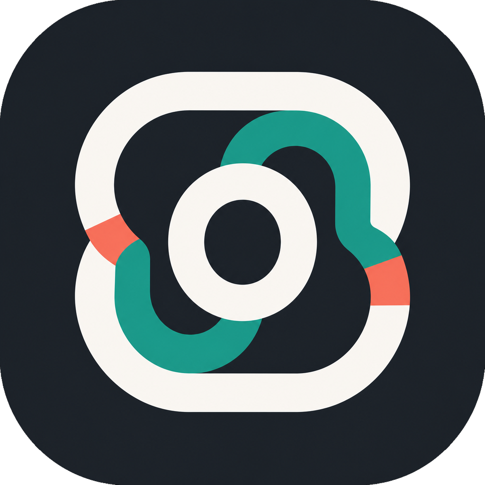
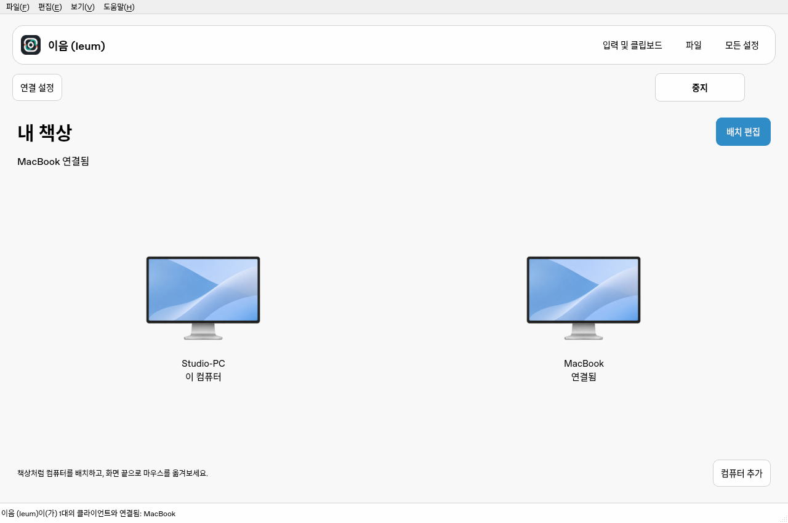
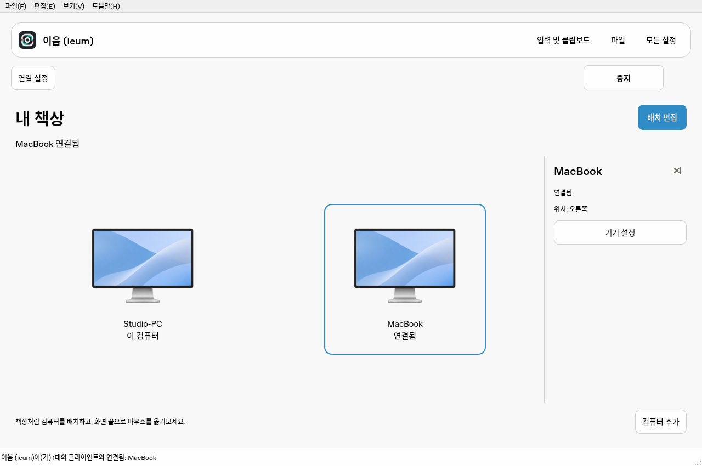
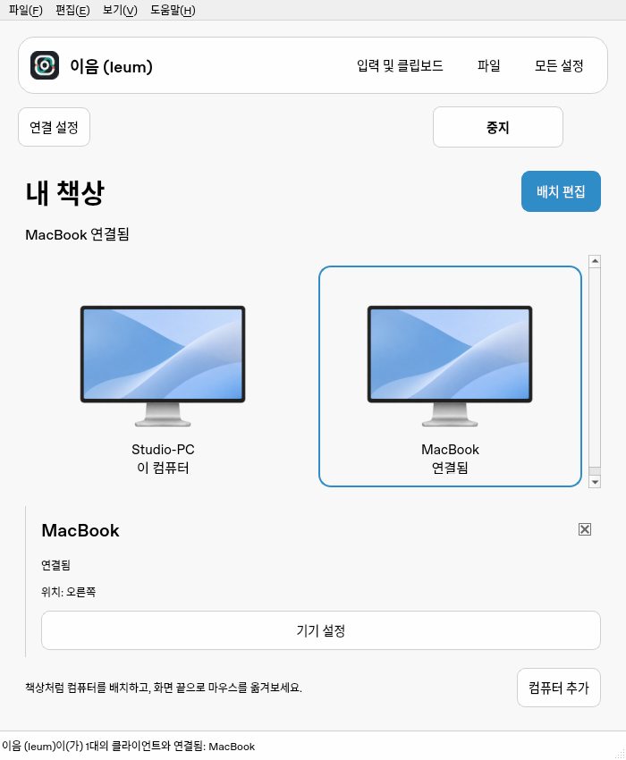
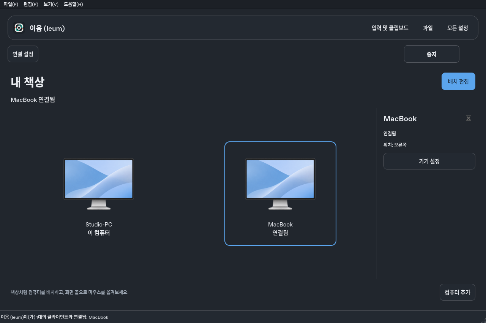
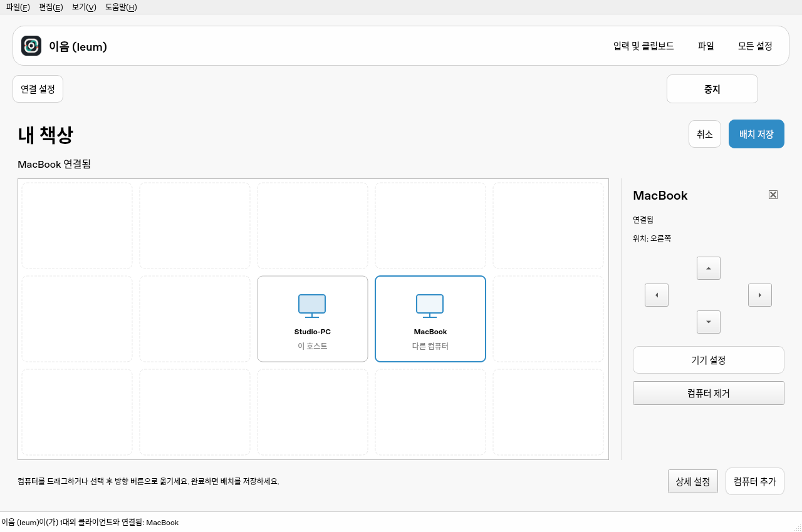
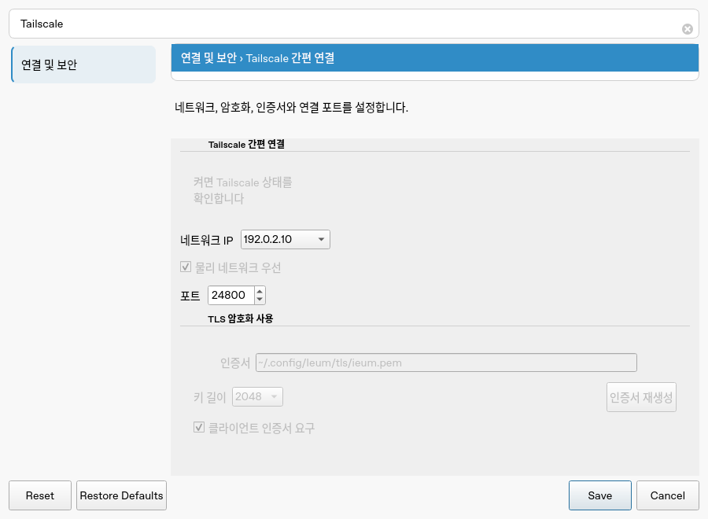
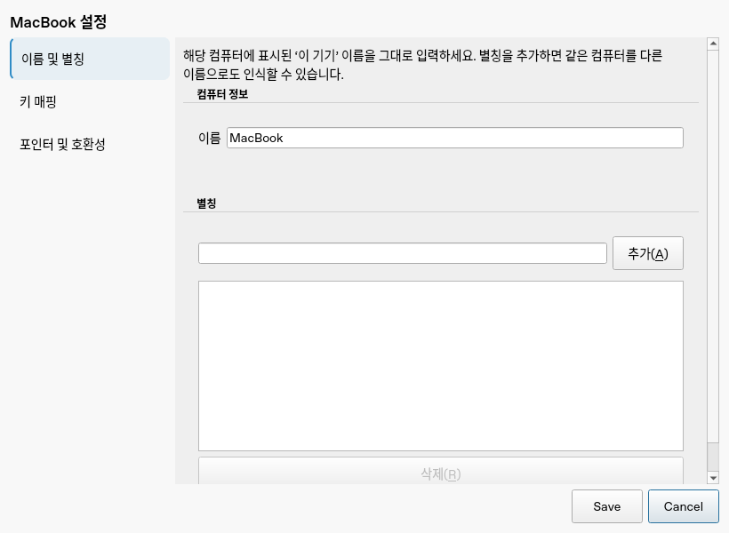

<!-- SPDX-FileCopyrightText: (C) 2026 Ieum contributors -->
<!-- SPDX-License-Identifier: GPL-2.0-only WITH LicenseRef-OpenSSL-Exception -->

<h1 align="center">Your computers. One keyboard and mouse.</h1>

Move between Windows, Mac, and Linux with Ieum.

<a href="https://github.com/Cherry-Company/ieum/releases"><strong>Download</strong></a> · <a href="#connect-your-computers">Get started</a> · <a href="docs/dev/build.md">Build guide</a>

<a href="README.md">한국어</a> · English · <a href="README.zh-CN.md">简体中文</a>

Screenshots show the Korean UI rendered on Linux with test devices and connection states.

## My desk in alpha.31

[Current release: v0.1.0-alpha.31](https://github.com/Cherry-Company/ieum/releases/tag/v0.1.0-alpha.31)

- **See your desk first.** The main screen shows the saved computer layout and actual Ieum connection state.
  Select a computer to see its name, state, position, and next steps.
- **Apply layout changes when you save.** Use **Edit layout** to add, move, or remove computers, then **Save layout**.
  **Cancel** restores the saved arrangement. Edit positions on the host.
- **Expand connection settings when needed.** Role, device name, address, and Tailscale selection live in **Connection settings**.
  The panel collapses when sharing starts; use the same button to reopen it.
- **Use a smaller window or dark mode.** Computer details move below the layout in narrow windows.
  The Mac toolbar uses a system translucent material and respects Reduce Transparency and Increase Contrast.

Selected computer, narrow window, and dark mode

## Move the pointer. Keep working.

Push your pointer across a screen edge to control the next computer. Your keyboard follows.
Copy text on one computer and paste it on another. Each computer keeps its own display and apps;
Ieum shares input rather than streaming a remote desktop.

| What you need | What Ieum provides |
| --- | --- |
| One set of input devices for your desk | Keyboard and mouse sharing across screen edges |
| Korean and CJK input across operating systems | Input-language synchronization and IME handling |
| Text between computers | Shared clipboard and Unicode normalization |
| Computers on different networks | Host selection through Tailscale |
| Files between Windows and Mac | Pro Local file drag and transfer |

## Connect your computers

Install Ieum on every computer. The **host** has the keyboard and mouse you want to share.
A **client** receives that input.
Open **Connection settings → First connection**, or press **F1**, for connection and Mac permission guidance.

1. On the host, expand **Connection settings**, choose **Share my keyboard and mouse**, then **Start**.
2. On the host, open **My desk → Edit layout → Add computer**. Enter the client's exact **This device** name
   shown in its **Connection settings**, and choose a side relative to the host. Press **Add computer** to add it
   to the draft, then **Save layout**. You can also drag computers or move them with the direction buttons.
3. On the client, expand **Connection settings** and choose **Use a shared keyboard and mouse**. Enter the host’s name or IP
   for a local network, or select it from the Tailscale list. Press **Connect** and verify the fingerprints on both computers.
   Once connected, move the pointer toward the screen edge you configured.

For Tailscale, sign both computers into the same tailnet and choose **Tailscale** as the connection method in both apps.
Tailscale's online indicator is separate from the Ieum connection state; that device also needs Ieum running as a host.

To change hosts, select another computer in the client’s host list. Ieum closes the previous connection and connects
to the new host automatically. A client connects to one host at a time. If a host keeps waiting, check the host
selected on the client, including whether it is already connected elsewhere.

## Install

Choose a package from the [alpha.31 release](https://github.com/Cherry-Company/ieum/releases/tag/v0.1.0-alpha.31).

| Computer | Package |
| --- | --- |
| Windows 10/11, Intel or AMD | [x64 MSI](https://github.com/Cherry-Company/ieum/releases/download/v0.1.0-alpha.31/Ieum-0.1.0-alpha.31-win-x64.msi) |
| Windows 10/11, ARM | [ARM64 MSI](https://github.com/Cherry-Company/ieum/releases/download/v0.1.0-alpha.31/Ieum-0.1.0-alpha.31-win-arm64.msi) |
| Apple Silicon Mac, macOS 14+ | [arm64 DMG](https://github.com/Cherry-Company/ieum/releases/download/v0.1.0-alpha.31/Ieum-0.1.0-alpha.31-macos-arm64.dmg) |
| Intel Mac, macOS 12+ | [x86_64 DMG](https://github.com/Cherry-Company/ieum/releases/download/v0.1.0-alpha.31/Ieum-0.1.0-alpha.31-macos-x86_64.dmg) |
| Linux | Distribution package; experimental support |

On Mac, move Ieum to Applications and grant Accessibility permission. Windows may need the matching Visual C++ runtime.
Windows installers are not code signed. Mac packages are ad-hoc signed, without Apple Developer ID signing or notarization.
[Detailed installation and permissions, in Korean](docs/user/installation.md).

## Find a setting

Use **Input and clipboard** or **Files** in the toolbar, or search in **All settings**.
Select a search result to jump to that control.

Layout editing and settings

| Change | Where |
| --- | --- |
| Role, host address, local network, Tailscale | **Connection settings** on the main screen |
| Add, move, or remove computers | **My desk → Edit layout** on the host, then **Save layout** |
| A computer’s name, aliases, and key mapping | **My desk → select a computer → Computer settings**, then **Save layout** |
| Detailed switching and pointer options | **Edit layout → More settings** on the host |
| Input language and clipboard text | **Input and clipboard** |
| Client scrolling and reconnection | **Receiving options** on the client |
| Encryption, certificates, ports | **Network settings → Connection & security** |
| File destination and Pro Local license | **Files** |
| Start at login | **All settings → General** |

Keyboard, mouse, input synchronization, and clipboard sharing are free. Windows ↔ macOS file transfers require
Pro Local activation on both computers and TLS. Pro Local Early Access is USD 30 once, with a license issued
manually by email after payment verification. [Activation and scope](docs/dev/pro_local_file_transfer.md).

If another window changes the layout, Ieum asks you to reload rather than overwrite it.
When using an external configuration file, manage positions in that file.

## Subscription plans in preparation

The new subscription plans are in development and **are not on sale yet**.
The published release remains alpha.31. Existing perpetual Pro Local keys retain
their file-transfer entitlement. The intended subscription packaging is:

| Plan | Monthly | Annually | Intended features |
| --- | ---: | ---: | --- |
| Free | Free | Free | Keyboard/mouse, Korean/English synchronization, text clipboard and TLS |
| Professional Local | US$1.99 | US$14.99 | Free plus direct file transfer |
| Professional | US$2.99 | US$24.99 | Local plus audio sharing |
| Professional Max | US$4.99 | US$39.99 | Professional plus control from either keyboard/mouse, remote viewing, image clipboard, coordinated lock/wake and simultaneous input |

Annual prices are charged once per year; applicable taxes appear at checkout.
Normal purchases will use Paddle subscriptions. After payment, activate Ieum and
save the separate subscription recovery code. Event and owner keys have their own
field. Hosting is prepared for Cloudflare Workers + D1 Free, with an owned subdomain
connected later; the service is not deployed yet. Cancellation retains access through the paid period; free
features and valid existing keys remain afterward. Audio, remote viewing and
bidirectional control still need implementation and physical acceptance, and
the live seller account must be connected. Moving existing image clipboard and
keyboard broadcast into Max is a policy change for that subscription release.
See the [pricing evidence and release conditions](docs/product/professional-plans.md).

## When a connection gets stuck

- **Host keeps waiting:** start sharing on the host and select that host on the client. If the client is connected elsewhere, switch hosts there.
- **Tailscale device is online but Ieum cannot connect:** run Ieum in Host mode on that device and allow TCP `24800` through its firewall and tailnet ACL.
- **Mac receives no input:** check Accessibility approval for the current app in Applications.
- **Report a problem:** use **Help → Report bug**, review the diagnostic, and select **Copy and open GitHub**.
  Paste it into the issue, describe what happened, and submit. If the browser fails, the same window keeps the address
  and lets you save a copy. Nothing is uploaded automatically.

## What has been verified

Alpha.31 passed builds, automated tests, and package checks on Windows x64/ARM64, Apple Silicon/Intel Mac, and Linux.
Windows upgrade checks and verification of the published files' checksums and bytes also passed.
[Release CI results](https://github.com/Cherry-Company/ieum/actions/runs/42170738135).

On Mac, cleanup of legacy login items now runs before the Accessibility guide. Physical reboot testing is still needed
to establish whether the reported startup error recurs. App-specific input, sleep/wake, and long sessions also need
physical-device testing. No new CPU or RAM reduction has been measured for this UI.
[UI behavior and validation notes, in Korean](docs/dev/desk-workspace.md) · [Report an issue](https://github.com/Cherry-Company/ieum/issues).

## Development and support

[Build and test](docs/dev/build.md) · [IME guide](docs/user/ime.md) · [Protocol](docs/dev/protocol_reference.md) ·
[Security](docs/SECURITY.md) · [GitHub Sponsors](https://github.com/sponsors/victoriousian)

Maintained by Cherry Company. Sponsorship supports signing, notarization, device testing, and releases.
[Sponsorship impact](docs/release/sponsorship-impact.md).

Ieum is forked from Deskflow `39bf4fb` and distributed under
[GPL-2.0-only WITH LicenseRef-OpenSSL-Exception](LICENSE), with upstream notices preserved.
