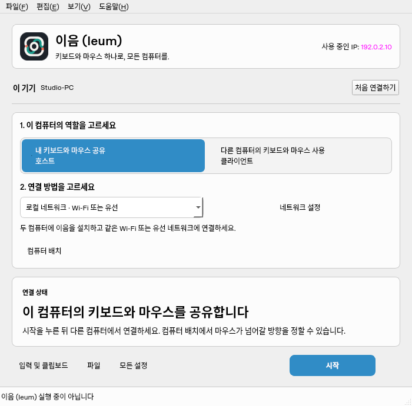
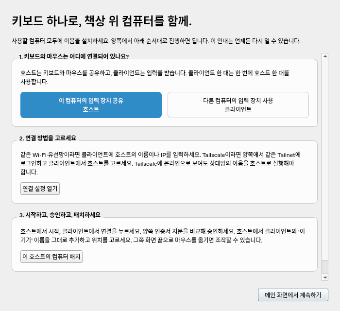
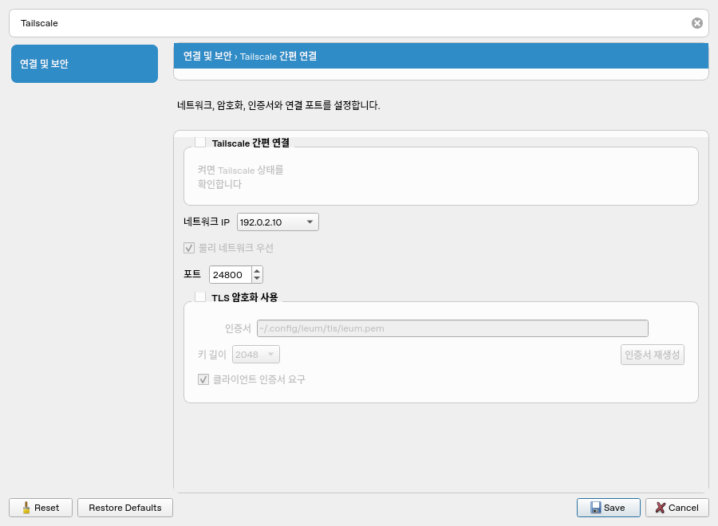
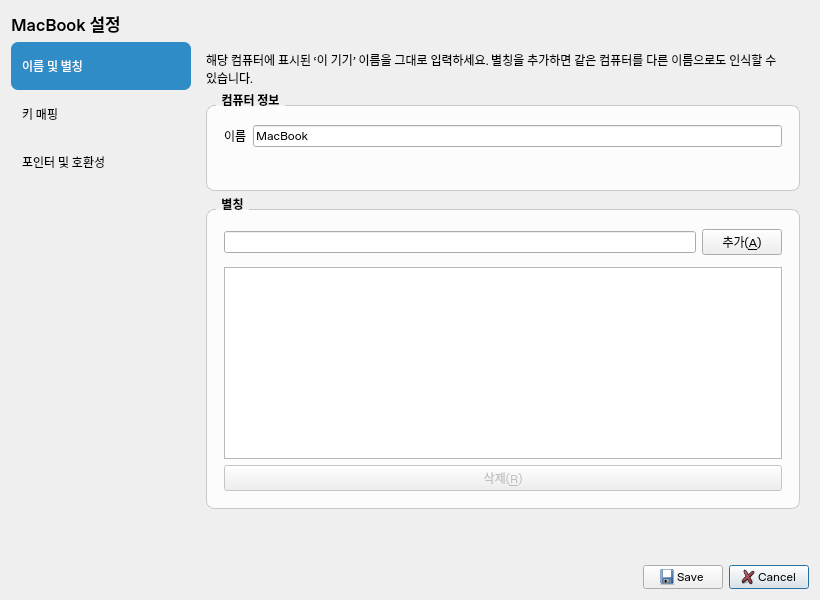
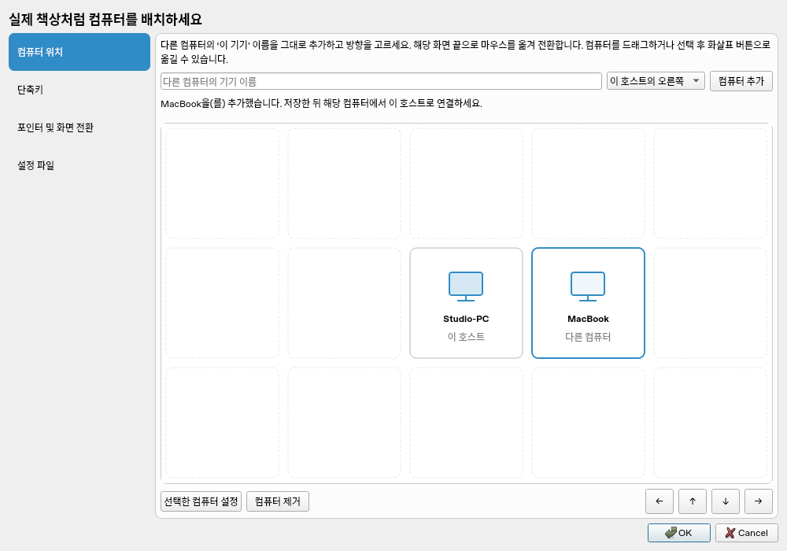

<!-- SPDX-FileCopyrightText: (C) 2026 Ieum contributors -->
<!-- SPDX-License-Identifier: GPL-2.0-only WITH LicenseRef-OpenSSL-Exception -->

<h1 align="center">책상 위 컴퓨터들이, 하나처럼.</h1>

키보드와 마우스 하나로 Windows, Mac, Linux를 오가세요. 이음 (Ieum)

<a href="https://github.com/Cherry-Company/ieum/releases"><strong>다운로드</strong></a> · <a href="#처음-연결하기">처음 연결하기</a> · <a href="docs/user/installation.md">설치 도움말</a>

한국어 · <a href="README.en.md">English</a> · <a href="README.zh-CN.md">简体中文</a>

새 인터페이스의 Linux 개발 화면입니다. 주소와 컴퓨터 이름은 예시입니다.

## 마우스를 옆 화면으로. 작업은 그대로.

Windows에서 쓰던 마우스를 화면 끝으로 밀면 옆의 Mac을 조작할 수 있습니다.
키보드도 함께 넘어가고, 복사한 텍스트는 다른 컴퓨터에 붙여 넣을 수 있습니다.
각 컴퓨터는 자기 화면과 앱을 그대로 사용합니다. 원격 화면을 스트리밍하는 프로그램은 아닙니다.

| 하고 싶은 일 | 이음에서 할 수 있는 것 |
| --- | --- |
| 컴퓨터마다 키보드와 마우스를 두기 번거로울 때 | 화면 경계를 넘어 입력 장치 공유 |
| Windows와 Mac을 오가며 한글을 입력할 때 | 한/영 입력 상태 동기화와 CJK 입력 처리 |
| 다른 컴퓨터에 문장을 옮길 때 | 클립보드 공유와 유니코드 텍스트 정규화 |
| 다른 네트워크의 컴퓨터를 연결할 때 | Tailscale 기기 목록에서 호스트 선택 |
| Windows와 Mac 사이에 파일을 옮길 때 | Pro Local 파일 드래그 전송 |

## 처음 연결하기

**사용할 컴퓨터 모두에 이음을 설치하세요.** 키보드와 마우스가 연결된 컴퓨터를 **호스트**,
그 입력을 받아 조작할 컴퓨터를 **클라이언트**라고 부릅니다.
앱의 **처음 연결하기**에서도 같은 순서와 Mac 권한 안내를 볼 수 있습니다.

앱의 첫 연결 안내 보기

1. **호스트에서 공유를 시작합니다.** `내 키보드와 마우스 공유`를 고르고 **시작**을 누릅니다.
2. **다른 컴퓨터에서 호스트를 고릅니다.** `다른 컴퓨터의 키보드와 마우스 사용`을 고릅니다.
   같은 Wi-Fi·유선망에서는 호스트의 이름이나 IP를 입력하고, Tailscale에서는 목록에서 고릅니다.
   **연결**을 누르고 양쪽의 지문을 확인해 승인합니다.
3. **책상처럼 배치합니다.** 호스트의 **컴퓨터 배치**에서 클라이언트의 **이 기기** 이름을 그대로 입력하고
   오른쪽·왼쪽·위·아래 위치를 골라 **컴퓨터 추가**를 누릅니다. 저장한 뒤 그쪽 화면 끝으로 마우스를 옮겨 보세요.

Tailscale을 쓴다면 두 컴퓨터에서 같은 Tailnet에 로그인하고, 양쪽 이음의 **연결 방법**을
**Tailscale**로 고르세요. Tailscale의 온라인 표시는 이음 연결 상태와 별개입니다.

**다른 호스트로 바꾸려면 클라이언트의 호스트 목록에서 새 컴퓨터를 고르세요.**
실행 중인 연결을 자동으로 종료한 뒤 새 호스트에 연결합니다.
호스트에 “다른 컴퓨터를 기다리는 중”이 보이면, 클라이언트가 그 호스트를 선택했는지 확인하세요.
클라이언트 한 대는 한 번에 호스트 한 대에 연결됩니다.

## 내 컴퓨터에 맞게 설치하기

[릴리스 페이지](https://github.com/Cherry-Company/ieum/releases)에서 운영체제와 CPU에 맞는 파일을 받으세요.

| 컴퓨터 | 설치 파일 | 첫 실행에서 할 일 |
| --- | --- | --- |
| Windows 10/11 · Intel/AMD | x64 MSI | 설치 후 이음 실행. 런타임 오류가 나면 Visual C++ 런타임 확인 |
| Windows 10/11 · Snapdragon 등 | ARM64 MSI | ARM64 파일 선택 |
| Mac · M1 이후 | macOS arm64 DMG | Applications로 옮기고 손쉬운 사용 권한 승인 |
| Mac · Intel | macOS x86_64 DMG | Applications로 옮기고 손쉬운 사용 권한 승인 |
| Linux | 배포판에 맞는 패키지 | [빌드·설치 안내](docs/dev/build.md) 확인. 실험적 지원 |

현재 알파 배포본은 Windows 코드 서명과 Apple 서명·공증 전입니다.
macOS 지원 버전, 설치 경고, 필요한 권한과 파일 검증은 [설치 도움말](docs/user/installation.md)에서 확인하세요.

## 설정을 찾을 때

메인 화면의 바로가기를 쓰거나 **모든 설정**에서 검색하세요. 검색 결과를 선택하면 해당 항목으로 이동합니다.

설정 화면 보기

이름과 방향으로 컴퓨터 배치하기

| 바꾸고 싶은 것 | 위치 |
| --- | --- |
| 호스트, 로컬 네트워크, Tailscale | 메인 화면의 연결 영역 |
| 화면 배치·전환 방향·포인터 속도 | 호스트의 **컴퓨터 배치** |
| 특정 컴퓨터의 이름·별칭·키 매핑 | **컴퓨터 배치 → 선택한 컴퓨터 설정** |
| 한/영 전환·입력기·클립보드 텍스트 | **입력 및 클립보드** |
| 입력받는 기기의 스크롤·재연결 | 클라이언트의 **이 기기 입력 설정** |
| 암호화·인증서·네트워크 포트 | **네트워크 설정 → 연결 및 보안** |
| 파일 수신 폴더·Pro Local 라이선스 | **파일** |
| 로그인할 때 자동 실행 | **모든 설정 → 일반** |

키보드·마우스·입력 상태·클립보드 공유는 무료입니다. Windows ↔ macOS 파일 전송에는
양쪽 컴퓨터의 Pro Local 활성화와 TLS가 필요합니다. Pro Local Early Access는 USD 30 일회성이며,
라이선스는 결제 확인 후 이메일로 수동 발급합니다. [기능과 활성화 방법](docs/dev/pro_local_file_transfer.md).

## 연결이 막히면

- **호스트가 기다리기만 해요:** 클라이언트의 연결 대상과 호스트의 공유 시작 상태를 확인하세요.
  클라이언트가 다른 호스트에 연결돼 있다면 클라이언트 쪽에서 대상을 바꾸세요.
- **Tailscale 기기는 보이는데 연결이 안 돼요:** 상대 컴퓨터에서도 이음이 호스트로 실행돼야 합니다.
  Tailnet ACL과 호스트 방화벽에서 TCP `24800`을 허용해야 합니다.
- **Mac에서 입력이 안 돼요:** 시스템 설정의 손쉬운 사용 권한과 현재 Applications의 이음 앱을 확인하세요.
- **문제를 제보하고 싶어요:** **도움말 → 오류 보고**에서 내용을 확인하고 **복사 후 GitHub 열기**를 누르세요.
  이슈에 진단을 붙여 넣고 당시 상황을 적어 제출합니다. 브라우저가 열리지 않아도 같은 창에서 주소를 복사하거나
  진단 파일을 저장할 수 있습니다. 자동 업로드는 하지 않습니다.

현재 알파 버전은 실기 안정성 검증을 진행 중입니다. 특정 앱의 입력, 잠자기 복귀와 실제 재부팅은
운영체제별 확인이 필요합니다. [문제 제보](https://github.com/Cherry-Company/ieum/issues).

## 개발과 후원

[빌드·테스트](docs/dev/build.md) · [입력기 안내](docs/user/ime.md) · [프로토콜](docs/dev/protocol_reference.md) ·
[보안](docs/SECURITY.md) · [GitHub Sponsors](https://github.com/sponsors/victoriousian)

Cherry Company가 유지관리합니다. 후원은 코드 서명·공증, 실기 테스트와 릴리스 유지에 사용합니다.
[후원 사용 내역](docs/release/sponsorship-impact.md).

이음은 Deskflow `39bf4fb`에서 포크했습니다.
[GPL-2.0-only WITH LicenseRef-OpenSSL-Exception](LICENSE)에 따라 배포하며 원저작자 고지를 유지합니다.
