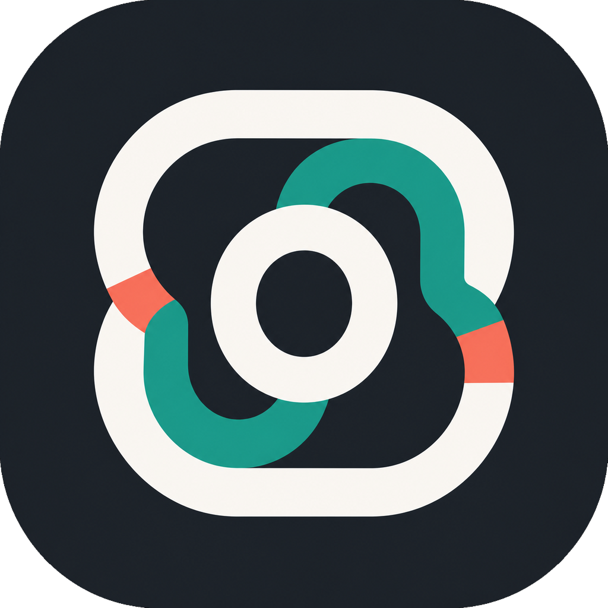
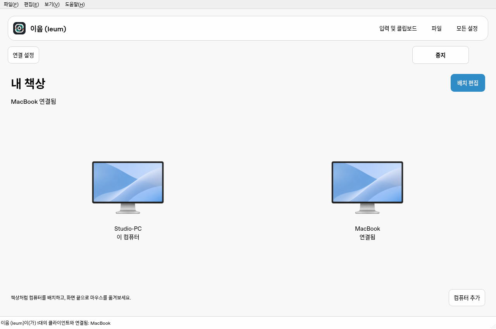
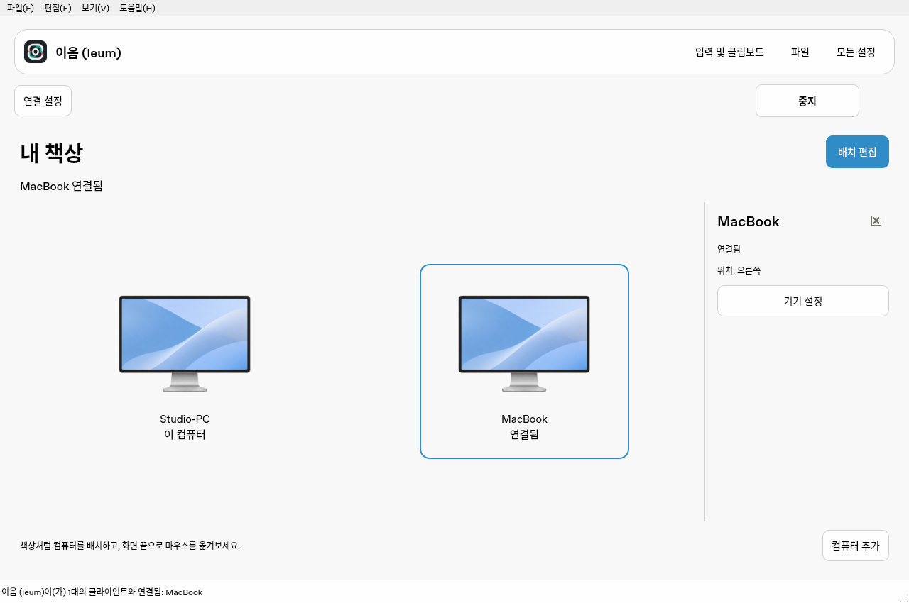
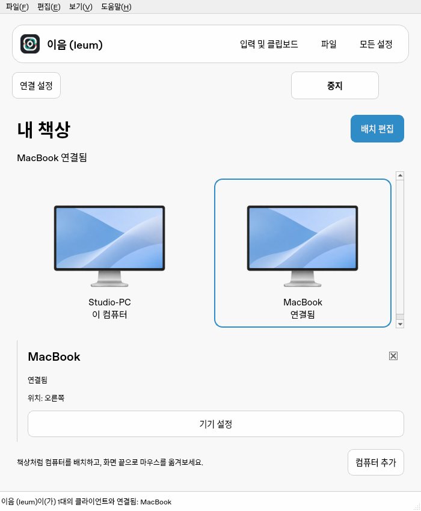
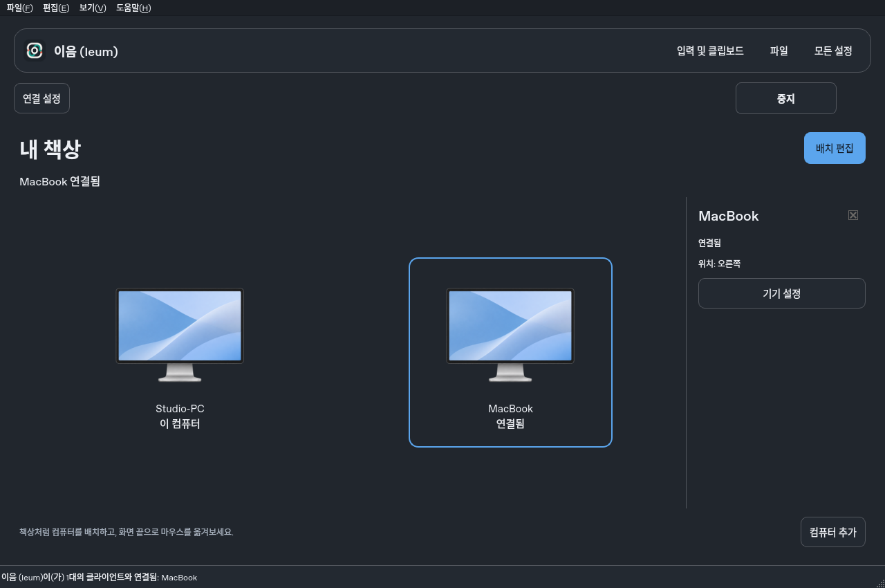
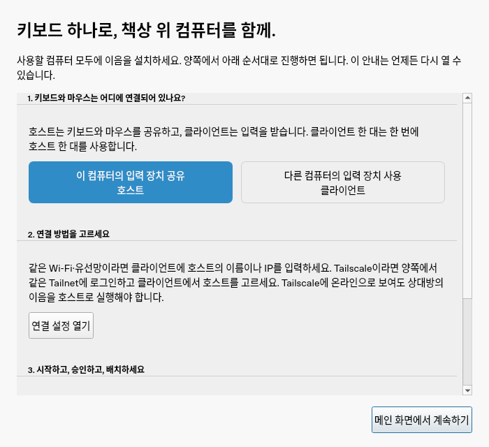
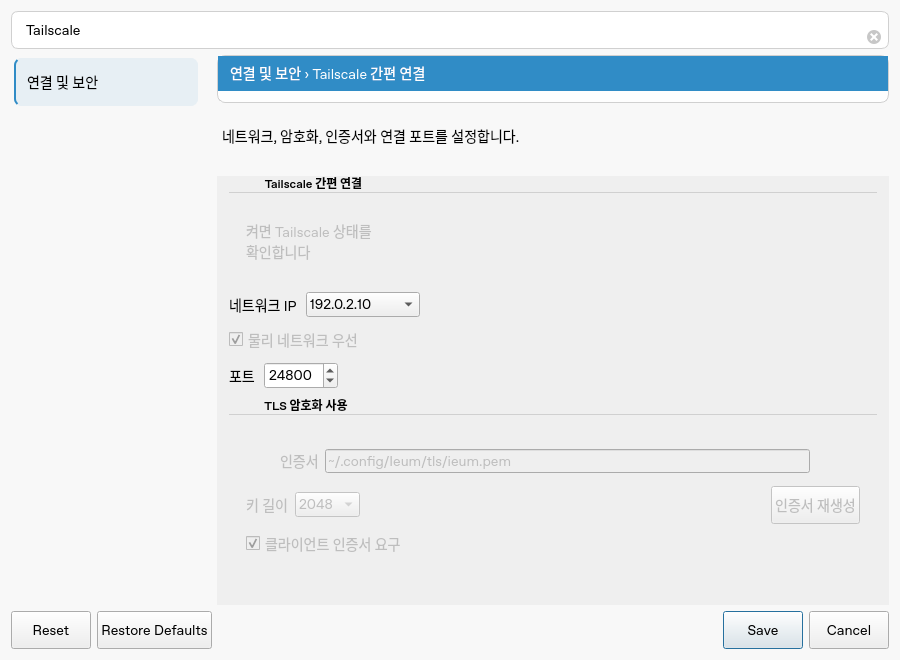
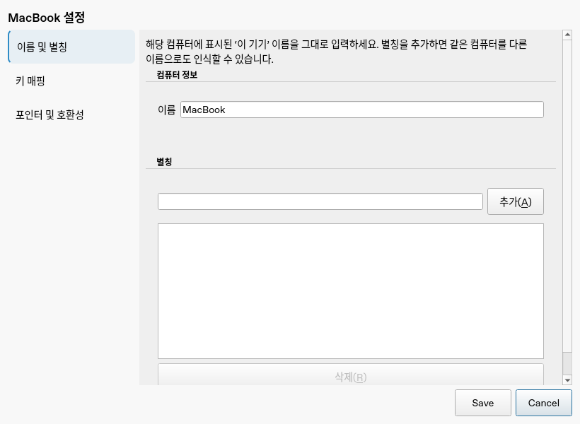
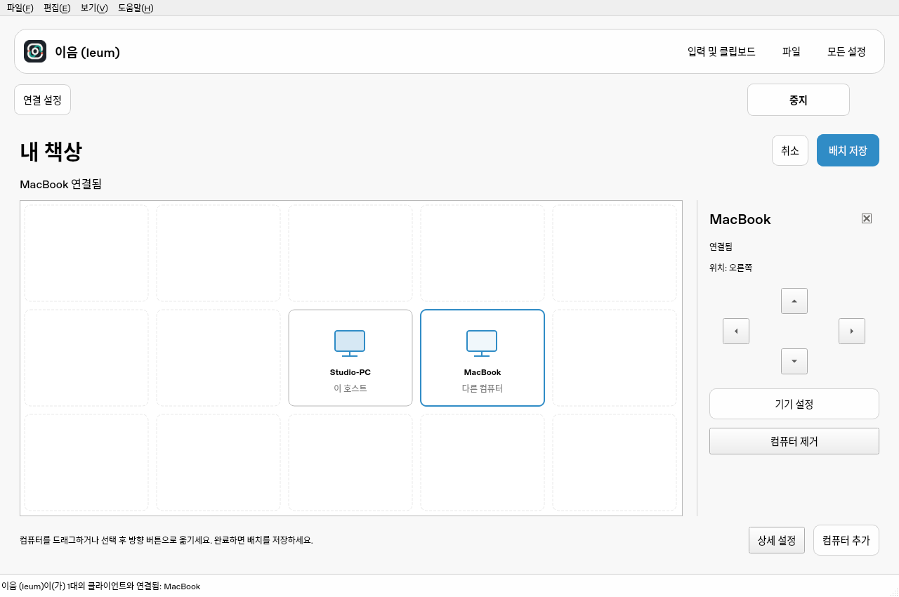

<!-- SPDX-FileCopyrightText: (C) 2026 Ieum contributors -->
<!-- SPDX-License-Identifier: GPL-2.0-only WITH LicenseRef-OpenSSL-Exception -->

<h1 align="center">책상 위 컴퓨터들이, 하나처럼.</h1>

키보드와 마우스 하나로 Windows, Mac, Linux를 오가세요. 이음 (Ieum)

<a href="https://github.com/Cherry-Company/ieum/releases"><strong>다운로드</strong></a> · <a href="#처음-연결하기">처음 연결하기</a> · <a href="docs/user/installation.md">설치 도움말</a>

한국어 · <a href="README.en.md">English</a> · <a href="README.zh-CN.md">简体中文</a>

스크린샷은 Linux에서 테스트용 기기와 연결 상태로 촬영한 한국어 UI입니다.

## alpha.33의 내 책상

[현재 배포본: v0.1.0-alpha.33](https://github.com/Cherry-Company/ieum/releases/tag/v0.1.0-alpha.33)

- **책상 배치를 먼저 봅니다.** 메인 화면에서 저장된 컴퓨터 배치와 실제 이음 연결 상태를 확인합니다.
  기기를 선택하면 이름·연결 상태·위치와 필요한 다음 행동이 나타납니다.
- **배치는 저장할 때 적용합니다.** **배치 편집**에서 컴퓨터를 추가·이동·제거하고 **배치 저장**으로 적용합니다.
  **취소**하면 저장된 배치로 돌아갑니다. 배치 편집은 호스트에서 합니다.
- **연결 설정은 필요할 때 펼칩니다.** 역할·기기 이름·주소·Tailscale 선택은 **연결 설정**에 모았습니다.
  공유를 시작하면 접히고, 같은 버튼으로 다시 열 수 있습니다.
- **작은 창과 어두운 모드에 대응합니다.** 창이 좁아지면 기기 정보가 배치 아래로 이동합니다.
  Mac 상단은 시스템 반투명 재질을 사용하며, 투명도 줄이기·고대비 설정을 따릅니다.

기기 선택 · 작은 창 · 어두운 모드 보기

## 마우스를 옆 화면으로. 작업은 그대로.

Windows에서 쓰던 마우스를 화면 끝으로 밀면 옆의 Mac을 조작할 수 있습니다.
키보드도 함께 넘어가고, 복사한 텍스트는 다른 컴퓨터에 붙여 넣을 수 있습니다.
각 컴퓨터는 자기 화면과 앱을 그대로 사용합니다. Professional Max에서는 공유 패널로 상대 주 화면도 볼 수 있습니다.

| 하고 싶은 일 | 이음에서 할 수 있는 것 |
| --- | --- |
| 컴퓨터마다 키보드와 마우스를 두기 번거로울 때 | 화면 경계를 넘어 입력 장치 공유 |
| Windows와 Mac을 오가며 한글을 입력할 때 | 한/영 입력 상태 동기화와 CJK 입력 처리 |
| 다른 컴퓨터에 문장을 옮길 때 | 클립보드 공유와 유니코드 텍스트 정규화 |
| 다른 네트워크의 컴퓨터를 연결할 때 | Tailscale 기기 목록에서 호스트 선택 |
| Windows와 Mac 사이에 파일을 옮길 때 | Pro Local 파일 드래그 전송 |

## 처음 연결하기

**사용할 컴퓨터 모두에 이음을 설치하세요.** 키보드와 마우스가 연결된 컴퓨터를 **호스트**,
그 입력을 받아 조작할 컴퓨터를 **클라이언트**라고 부릅니다.
**연결 설정 → 처음 연결하기** 또는 **F1**에서 연결 절차와 Mac 권한 안내를 볼 수 있습니다.

앱의 첫 연결 안내 보기

1. **호스트에서 공유를 시작합니다.** **연결 설정**을 펼쳐 `내 키보드와 마우스 공유`를 고르고 **시작**을 누릅니다.
2. **호스트에서 책상처럼 배치합니다.** **내 책상 → 배치 편집 → 컴퓨터 추가**를 누릅니다.
   클라이언트의 **연결 설정**에 표시된 **이 기기** 이름을 그대로 입력하고, 호스트 기준 오른쪽·왼쪽·위·아래를 고릅니다.
   **컴퓨터 추가**로 초안에 넣고 **배치 저장**을 누릅니다. 기기를 드래그하거나 방향 버튼으로 옮길 수도 있습니다.
3. **클라이언트에서 호스트에 연결합니다.** **연결 설정**에서 `다른 컴퓨터의 키보드와 마우스 사용`을 고릅니다.
   같은 Wi-Fi·유선망에서는 호스트의 이름이나 IP를 입력하고, Tailscale에서는 목록에서 고릅니다.
   **연결**을 누르고 양쪽의 지문을 확인해 승인합니다. 연결되면 배치한 쪽의 화면 끝으로 마우스를 옮겨 보세요.

Tailscale을 쓴다면 두 컴퓨터에서 같은 Tailnet에 로그인하고, 양쪽 이음의 **연결 방법**을
**Tailscale**로 고르세요. Tailscale의 온라인 표시는 이음 연결 상태와 별개입니다.

**다른 호스트로 바꾸려면 클라이언트의 호스트 목록에서 새 컴퓨터를 고르세요.**
실행 중인 연결을 자동으로 종료한 뒤 새 호스트에 연결합니다.
호스트에 “다른 컴퓨터를 기다리는 중”이 보이면, 클라이언트가 그 호스트를 선택했는지 확인하세요.
클라이언트 한 대는 한 번에 호스트 한 대에 연결됩니다.

## 내 컴퓨터에 맞게 설치하기

[alpha.33 릴리스](https://github.com/Cherry-Company/ieum/releases/tag/v0.1.0-alpha.33)에서 운영체제와 CPU에 맞는 파일을 받으세요.

| 컴퓨터 | 설치 파일 | 첫 실행에서 할 일 |
| --- | --- | --- |
| Windows 10/11 · Intel/AMD | [x64 한국어 MSI](https://github.com/Cherry-Company/ieum/releases/download/v0.1.0-alpha.33/Ieum-0.1.0-alpha.33-win-x64-ko-KR.msi) | 설치 후 이음 실행. 런타임 오류가 나면 Visual C++ 런타임 확인 |
| Windows 10/11 · Snapdragon 등 | [ARM64 한국어 MSI](https://github.com/Cherry-Company/ieum/releases/download/v0.1.0-alpha.33/Ieum-0.1.0-alpha.33-win-arm64-ko-KR.msi) | ARM64 파일 선택 |
| Mac · M1 이후, macOS 14+ | [arm64 DMG](https://github.com/Cherry-Company/ieum/releases/download/v0.1.0-alpha.33/Ieum-0.1.0-alpha.33-macos-arm64.dmg) | Applications로 옮기고 손쉬운 사용 권한 승인 |
| Mac · Intel, macOS 12+ | [x86_64 DMG](https://github.com/Cherry-Company/ieum/releases/download/v0.1.0-alpha.33/Ieum-0.1.0-alpha.33-macos-x86_64.dmg) | Applications로 옮기고 손쉬운 사용 권한 승인 |
| Linux | 배포판에 맞는 패키지 | [빌드·설치 안내](docs/dev/build.md) 확인. 실험적 지원 |

Windows 설치 파일은 정식 코드 서명 전입니다. Mac 패키지는 ad-hoc 서명 상태이며 Apple Developer ID 서명·공증 전입니다.
macOS 지원 버전, 설치 경고, 필요한 권한과 파일 검증은 [설치 도움말](docs/user/installation.md)에서 확인하세요.

## 설정을 찾을 때

상단의 **입력 및 클립보드**·**파일** 바로가기를 쓰거나 **모든 설정**에서 검색하세요.
검색 결과를 선택하면 해당 항목으로 이동합니다.

설정 화면 보기

이름과 방향으로 컴퓨터 배치하기

| 바꾸고 싶은 것 | 위치 |
| --- | --- |
| 역할, 호스트 주소, 로컬 네트워크, Tailscale | 메인 화면의 **연결 설정** |
| 컴퓨터 추가·이동·제거 | 호스트의 **내 책상 → 배치 편집**, 완료 후 **배치 저장** |
| 특정 컴퓨터의 이름·별칭·키 매핑 | **내 책상 → 기기 선택 → 기기 설정**, 완료 후 **배치 저장** |
| 화면 전환·포인터 등 상세 옵션 | 호스트의 **배치 편집 → 상세 설정** |
| 한/영 전환·입력기·클립보드 텍스트 | **입력 및 클립보드** |
| 입력받는 기기의 스크롤·재연결 | 클라이언트의 **이 기기 입력 설정** |
| 암호화·인증서·네트워크 포트 | **네트워크 설정 → 연결 및 보안** |
| 파일 수신 폴더·Pro Local 라이선스 | **파일** |
| 로그인할 때 자동 실행 | **모든 설정 → 일반** |

키보드·마우스·입력 상태·클립보드 공유는 무료입니다. Windows ↔ macOS 파일 전송에는
양쪽 컴퓨터의 Pro Local 활성화와 TLS가 필요합니다. Pro Local Early Access는 USD 30 일회성이며,
라이선스는 결제 확인 후 이메일로 수동 발급합니다. [기능과 활성화 방법](docs/dev/pro_local_file_transfer.md).

다른 창에서 배치가 바뀌면 편집 내용을 덮어쓰지 않고 다시 읽도록 안내합니다.
외부 설정 파일을 사용하는 경우 배치는 해당 파일에서 관리합니다.

## 준비 중인 구독 플랜

새 구독 플랜은 개발 중이며 **아직 구매할 수 없습니다**. 현재 배포본은 alpha.33입니다.
기존 Pro Local 영구 키의 파일 전송 권한은 유지됩니다. 다음 구독판은 아래처럼 구분합니다.

| 플랜 | 월 결제 | 연 결제 | 포함할 기능 |
| --- | ---: | ---: | --- |
| 일반 · Free | 무료 | 무료 | 키보드·마우스, 한/영 동기화, 텍스트 클립보드, TLS |
| Professional Local | US$1.99 | US$14.99 | 무료 기능 + 직접 파일 전송 |
| Professional | US$2.99 | US$24.99 | Local + 오디오 공유 |
| Professional Max | US$4.99 | US$39.99 | Professional + 양방향 제어, 원격 화면 보기, 이미지 클립보드, 잠금·깨우기 연동, 동시 입력 |

연간 요금은 1년분을 한 번에 결제하는 금액이며, 적용되는 세금은 결제 화면에서 표시합니다.
일반 구매는 Paddle 구독 결제로 준비합니다. 결제 후 이음에서 활성화하고, 별도로 받은 구독 복원 코드를 저장합니다.
이벤트·소유자 키는 앱의 별도 입력란을 사용합니다. 결제 서비스는 Cloudflare Workers + D1 무료 플랜으로
준비하고 있으며 아직 운영 배포 전입니다. 보유 도메인의 서브도메인은 이후 연결합니다.
구독을 해지해도 결제한 기간까지 이용할 수 있고, 이후 무료 기능과 유효한 기존 키는 유지됩니다.
현재 개발본에는 시스템 오디오, 원격 화면, 양방향 키보드·마우스 제어, 잠금·깨우기, 마우스를 포함한 동시 입력을 구현했습니다.
상단 **작업 공간 공유**에서 상대를 선택하고 허용을 받아 시작합니다. 저장된 허용 취소와 트레이에서 중지도 지원합니다.
화면은 주 모니터의 최대 720p·5fps이며, macOS 오디오는 13 이상이 필요합니다. Linux의 새 화면·입력 공유는 X11에서 지원합니다.
Windows↔macOS 실기기 검증과 실제 판매 계정 연결은 아직 남아 있습니다. [공유 사용법과 지원 범위](docs/product/workspace-sharing.ko.md)를 확인하세요.
기존 이미지 클립보드와 키보드 동시 전송의 Max 분류도 다음 구독판의 정책 변경에 해당합니다.
[가격 조사와 기능별 출시 조건](docs/product/professional-plans.md)을 확인하세요.

## 연결이 막히면

- **호스트가 기다리기만 해요:** 클라이언트의 연결 대상과 호스트의 공유 시작 상태를 확인하세요.
  클라이언트가 다른 호스트에 연결돼 있다면 클라이언트 쪽에서 대상을 바꾸세요.
- **Tailscale 기기는 보이는데 연결이 안 돼요:** 상대 컴퓨터에서도 이음이 호스트로 실행돼야 합니다.
  Tailnet ACL과 호스트 방화벽에서 TCP `24800`을 허용해야 합니다.
- **Mac에서 입력이 안 돼요:** 시스템 설정의 손쉬운 사용 권한과 현재 Applications의 이음 앱을 확인하세요.
- **문제를 제보하고 싶어요:** **도움말 → 오류 보고**에서 내용을 확인하고 **복사 후 GitHub 열기**를 누르세요.
  이슈에 진단을 붙여 넣고 당시 상황을 적어 제출합니다. 브라우저가 열리지 않아도 같은 창에서 주소를 복사하거나
  진단 파일을 저장할 수 있습니다. 자동 업로드는 하지 않습니다.

## 확인한 범위와 남은 검증

alpha.31은 Windows x64/ARM64, Mac Apple Silicon/Intel과 Linux의 빌드·자동 테스트·패키지 검사를 통과했습니다.
Windows 업그레이드 검사와 게시된 파일의 체크섬·바이트 대조도 완료했습니다.
[릴리스 CI 결과](https://github.com/Cherry-Company/ieum/actions/runs/42170738135).

Mac에서는 손쉬운 사용 권한 안내보다 이전 로그인 항목 정리를 먼저 시도하도록 바꿨습니다.
다만 실제 재부팅에서 오류가 재발하지 않는다는 실기 검증은 남아 있습니다.
특정 앱의 입력, 잠자기 복귀와 장시간 연결도 운영체제별 확인이 필요합니다.
새 UI의 CPU/RAM 절감률은 측정하지 않았습니다.
[UI 동작과 검증 기록](docs/dev/desk-workspace.md) · [문제 제보](https://github.com/Cherry-Company/ieum/issues).

## 개발과 후원

[빌드·테스트](docs/dev/build.md) · [입력기 안내](docs/user/ime.md) · [프로토콜](docs/dev/protocol_reference.md) ·
[보안](docs/SECURITY.md) · [GitHub Sponsors](https://github.com/sponsors/victoriousian)

Cherry Company가 유지관리합니다. 후원은 코드 서명·공증, 실기 테스트와 릴리스 유지에 사용합니다.
[후원 사용 내역](docs/release/sponsorship-impact.md).

이음은 Deskflow `39bf4fb`에서 포크했습니다.
[GPL-2.0-only WITH LicenseRef-OpenSSL-Exception](LICENSE)에 따라 배포하며 원저작자 고지를 유지합니다.
