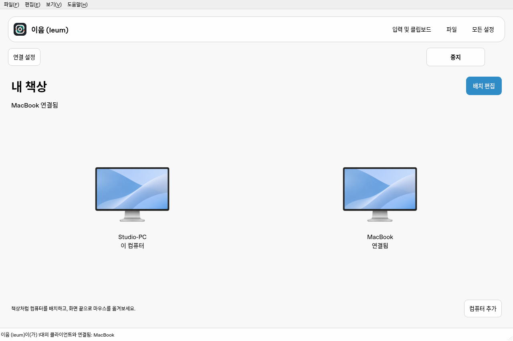
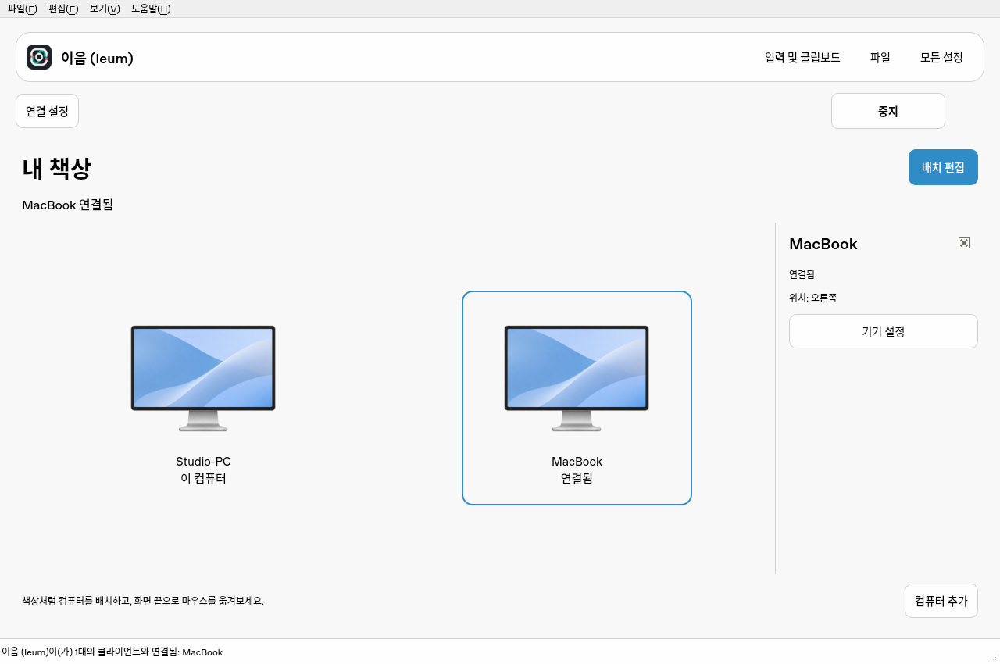
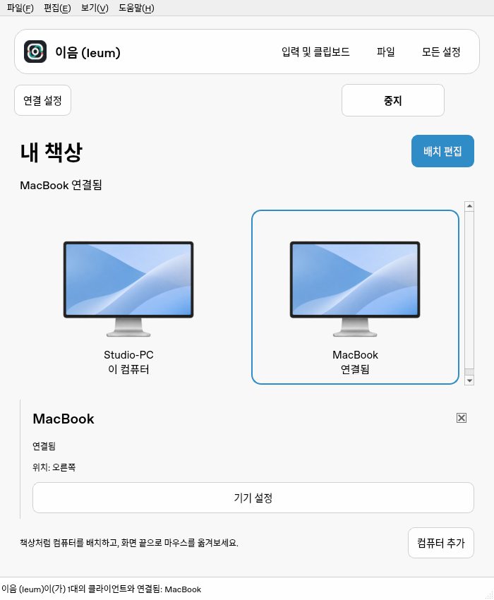
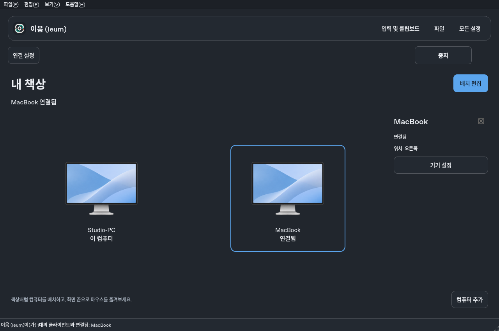
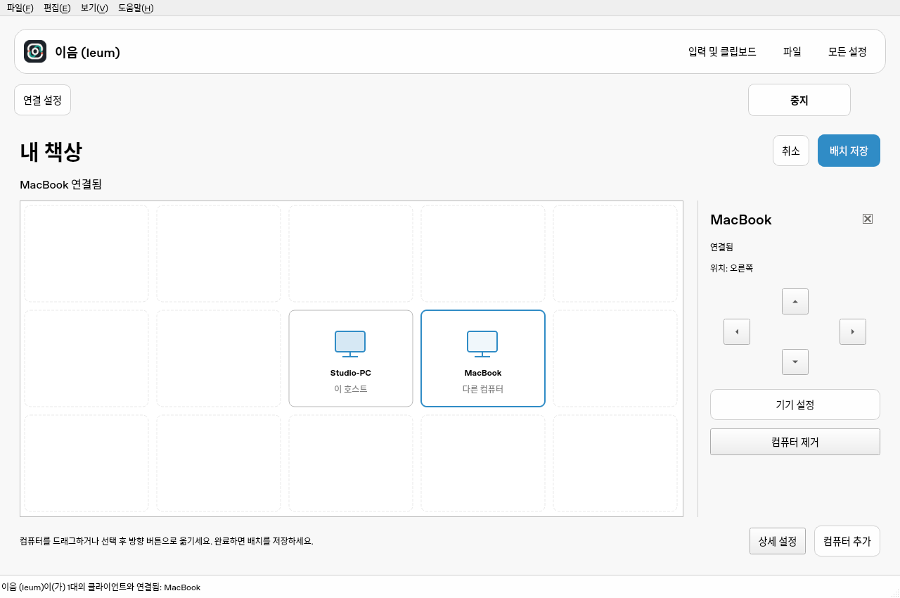
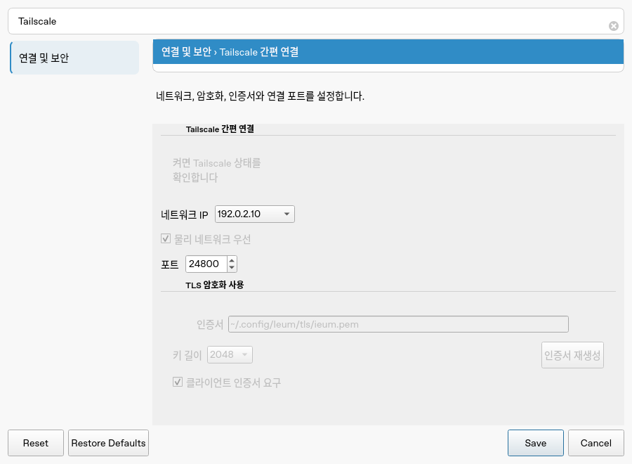
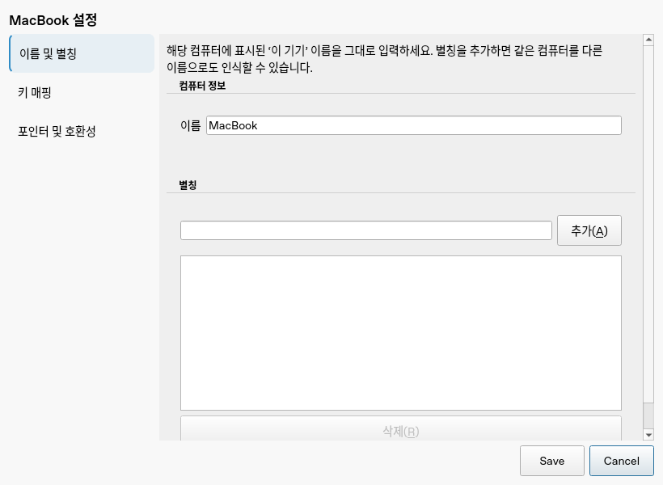

<!-- SPDX-FileCopyrightText: (C) 2026 Ieum contributors -->
<!-- SPDX-License-Identifier: GPL-2.0-only WITH LicenseRef-OpenSSL-Exception -->

<h1 align="center">多台电脑，一套键鼠。</h1>

用 Ieum 在 Windows、Mac 和 Linux 之间移动。

<a href="https://github.com/Cherry-Company/ieum/releases"><strong>下载</strong></a> · <a href="#连接电脑">开始连接</a> · <a href="docs/dev/build.md">构建指南</a>

<a href="README.md">한국어</a> · <a href="README.en.md">English</a> · 简体中文

截图为 Linux 上的韩语界面，使用测试设备及连接状态。

## alpha.31 的桌面布局

[当前版本：v0.1.0-alpha.31](https://github.com/Cherry-Company/ieum/releases/tag/v0.1.0-alpha.31)

- **先看到自己的桌面。** 主界面显示已保存的电脑布局和实际 Ieum 连接状态。
  选择一台电脑，即可查看名称、状态、位置和下一步操作。
- **保存后再应用布局。** 在 **Edit layout** 中添加、移动或移除电脑，再点击 **Save layout**。
  **Cancel** 会恢复已保存的布局。电脑位置在主机上编辑。
- **需要时展开连接设置。** 角色、设备名称、地址和 Tailscale 选择集中在 **Connection settings** 中。
  开始共享后面板会收起，点击同一按钮可再次展开。
- **适应窄窗口和深色模式。** 窗口变窄时，设备详情移到布局下方。
  Mac 顶部工具栏采用系统半透明材质，并遵循“减少透明度”和“增强对比度”设置。

设备详情、窄窗口与深色模式

## 鼠标移过去，接着工作。

将指针移过屏幕边缘，就能操作旁边的电脑。键盘输入也会一起切换。
在一台电脑上复制文字，在另一台上粘贴。每台电脑保留自己的屏幕和应用，Ieum 共享键鼠输入，不传输远程桌面画面。

| 想做什么 | Ieum 提供什么 |
| --- | --- |
| 用一套键鼠操作多台电脑 | 跨屏幕边缘共享输入 |
| 跨系统输入韩语和中日韩文字 | 输入语言同步与输入法处理 |
| 在电脑之间移动文字 | 剪贴板共享与 Unicode 规范化 |
| 连接不同网络的电脑 | 从 Tailscale 设备列表选择主机 |
| 在 Windows 与 Mac 之间传文件 | Pro Local 文件拖放传输 |

## 连接电脑

在所有电脑上安装 Ieum。连接着键盘和鼠标的电脑是**主机**，接收输入的电脑是**客户端**。
打开 **Connection settings → First connection**，或按 **F1**，可查看连接步骤及 Mac 权限说明。

1. 在主机上展开 **Connection settings**，选择 **Share my keyboard and mouse**，点击 **Start**。
2. 在主机上打开 **My desk → Edit layout → Add computer**。输入客户端 **Connection settings** 中显示的完整
   **This device** 名称，选择相对主机的方向。点击 **Add computer** 加入草稿，再点击 **Save layout**。
   也可以拖动电脑，或使用方向按钮调整位置。
3. 在客户端展开 **Connection settings**，选择 **Use a shared keyboard and mouse**。局域网连接时输入主机名称或 IP，
   Tailscale 连接时从列表选择主机。点击 **Connect**，核对并接受两台电脑上的指纹。
   连接后，将鼠标移向已设置的屏幕边缘即可。

使用 Tailscale 时，两台电脑都要登录同一个 tailnet，并在 Ieum 主界面选择 **Tailscale** 连接方式。
Tailscale 的在线状态与 Ieum 的连接状态不同；对方电脑仍需在 Ieum 中启动主机共享。

要切换主机，在客户端的主机列表中选择另一台电脑即可。Ieum 会自动断开旧连接并建立新连接。
一个客户端同时只能连接一台主机。如果主机一直等待，请检查客户端选中的主机，尤其是它是否已经连接了别的电脑。

## 安装

从 [alpha.31 发行页面](https://github.com/Cherry-Company/ieum/releases/tag/v0.1.0-alpha.31)选择对应的安装文件。

| 电脑 | 安装文件 |
| --- | --- |
| Windows 10/11，Intel 或 AMD | [x64 MSI（英文安装程序）](https://github.com/Cherry-Company/ieum/releases/download/v0.1.0-alpha.31/Ieum-0.1.0-alpha.31-win-x64.msi) |
| Windows 10/11，ARM | [ARM64 MSI（英文安装程序）](https://github.com/Cherry-Company/ieum/releases/download/v0.1.0-alpha.31/Ieum-0.1.0-alpha.31-win-arm64.msi) |
| Apple Silicon Mac，macOS 14 及以上 | [arm64 DMG](https://github.com/Cherry-Company/ieum/releases/download/v0.1.0-alpha.31/Ieum-0.1.0-alpha.31-macos-arm64.dmg) |
| Intel Mac，macOS 12 及以上 | [x86_64 DMG](https://github.com/Cherry-Company/ieum/releases/download/v0.1.0-alpha.31/Ieum-0.1.0-alpha.31-macos-x86_64.dmg) |
| Linux | 对应发行版的软件包；实验性支持 |

Mac 用户需将应用移到 Applications，并授予辅助功能权限。Windows 可能需要对应架构的 Visual C++ 运行库。
Windows 安装程序尚未代码签名。Mac 软件包使用临时签名（ad-hoc），尚无 Apple Developer ID 签名，也未通过 Apple 公证。
[详细安装与权限说明（韩语）](docs/user/installation.md)。

## 找到需要的设置

使用顶部工具栏的 **Input and clipboard**、**Files** 入口，或在 **All settings** 中搜索。
选择搜索结果即可跳转到对应设置。

布局编辑与设置界面

| 要修改什么 | 位置 |
| --- | --- |
| 角色、主机地址、局域网和 Tailscale | 主界面的 **Connection settings** |
| 添加、移动或移除电脑 | 主机的 **My desk → Edit layout**，完成后点击 **Save layout** |
| 单台电脑的名称、别名和按键映射 | **My desk → 选择电脑 → Computer settings**，完成后点击 **Save layout** |
| 切换行为、指针等详细选项 | 主机的 **Edit layout → More settings** |
| 输入语言与剪贴板文字 | **Input and clipboard** |
| 客户端滚动和重连方式 | 客户端的 **Receiving options** |
| 加密、证书、端口 | **Network settings → Connection & security** |
| 接收文件夹与 Pro Local 许可证 | **Files** |
| 登录时自动启动 | **All settings → General** |

键鼠共享、输入状态同步和剪贴板免费。Windows ↔ macOS 文件传输需要两台电脑都激活 Pro Local，并启用 TLS。
Pro Local Early Access 为一次性 USD 30，付款确认后通过邮件人工发放许可证。
[激活方法与功能范围](docs/dev/pro_local_file_transfer.md)。

其他窗口修改布局后，Ieum 会提示重新读取，避免覆盖更改。
使用外部配置文件时，请在该文件中管理电脑位置。

## 正在准备的订阅方案

新订阅方案仍在开发中，**尚未开售**。当前发行版本仍为 alpha.31。
已有的 Pro Local 永久许可证继续保留文件传输权限。订阅版计划如下：

| 方案 | 按月付费 | 按年付费 | 计划包含的功能 |
| --- | ---: | ---: | --- |
| Free | 免费 | 免费 | 键盘鼠标、韩英输入同步、文本剪贴板及 TLS |
| Professional Local | US$1.99 | US$14.99 | 免费功能及直接文件传输 |
| Professional | US$2.99 | US$24.99 | Local 及音频共享 |
| Professional Max | US$4.99 | US$39.99 | Professional 及双向控制、远程画面、图像剪贴板、联动锁定与唤醒、同时输入 |

年费为一次支付一年的金额，适用税费将在结账时显示。
普通购买采用订阅方式；考虑韩国收款和全球销售，优先评估 Polar。活动及所有者密钥保留独立输入框。
授权 API 可部署到自有域名的子域名，不依赖 Vercel。
取消订阅后可继续使用至已付费周期结束；免费功能及有效的旧许可证继续可用。
音频、远程画面、双向控制仍需实现并通过实机验证，正式卖家账户也尚未连接。
将现有图像剪贴板和键盘广播归入 Max 属于下一订阅版的权限政策变更。
详情见[定价依据及发布条件](docs/product/professional-plans.md)。

## 无法连接时

- **主机一直等待：** 在主机启动共享，并在客户端选择这台主机。若客户端已连接其他主机，请在客户端切换。
- **Tailscale 显示在线却无法连接：** 在对方电脑上启动 Ieum 主机共享，并检查防火墙和 tailnet ACL 是否允许 TCP `24800`。
- **Mac 无法接收输入：** 检查 Applications 中当前 Ieum 应用的辅助功能权限。
- **报告问题：** 在 **Help → Report bug** 中查看诊断内容，点击 **Copy and open GitHub**，粘贴到 Issue 并描述当时的操作后提交。
  浏览器无法打开时，可使用显示的地址或保存的诊断文件。应用不会自动上传。

## 已完成的验证与剩余测试

Alpha.31 已通过 Windows x64/ARM64、Apple Silicon/Intel Mac 和 Linux 的构建、自动测试及软件包检查。
Windows 升级安装检查，以及已发布文件的校验和与字节比对也已通过。
[发行 CI 结果](https://github.com/Cherry-Company/ieum/actions/runs/42170738135)。

Mac 现在会先尝试清理旧登录项，再显示辅助功能权限说明。是否仍会在实际重启后出现先前的启动错误，
还需要实机验证。特定应用中的输入、休眠恢复和长时间连接也需要分平台实机测试。
尚未测量新界面的 CPU 或内存节省幅度。
[界面行为与验证记录（韩语）](docs/dev/desk-workspace.md) · [提交问题](https://github.com/Cherry-Company/ieum/issues)。

## 开发与支持

[构建测试](docs/dev/build.md) · [输入法指南](docs/user/ime.md) · [协议](docs/dev/protocol_reference.md) ·
[安全](docs/SECURITY.md) · [GitHub Sponsors](https://github.com/sponsors/victoriousian)

由 Cherry Company 维护。赞助用于签名、公证、实机测试与发行维护。
[赞助使用记录](docs/release/sponsorship-impact.md)。

Ieum 从 Deskflow `39bf4fb` 分叉，按 [GPL-2.0-only WITH LicenseRef-OpenSSL-Exception](LICENSE) 分发，并保留上游版权声明。
