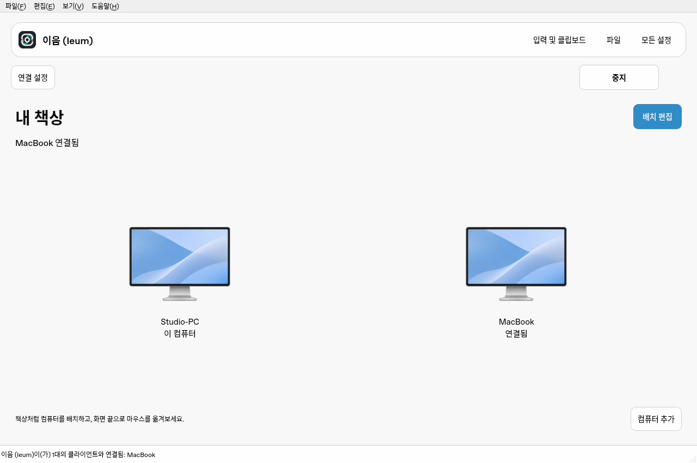
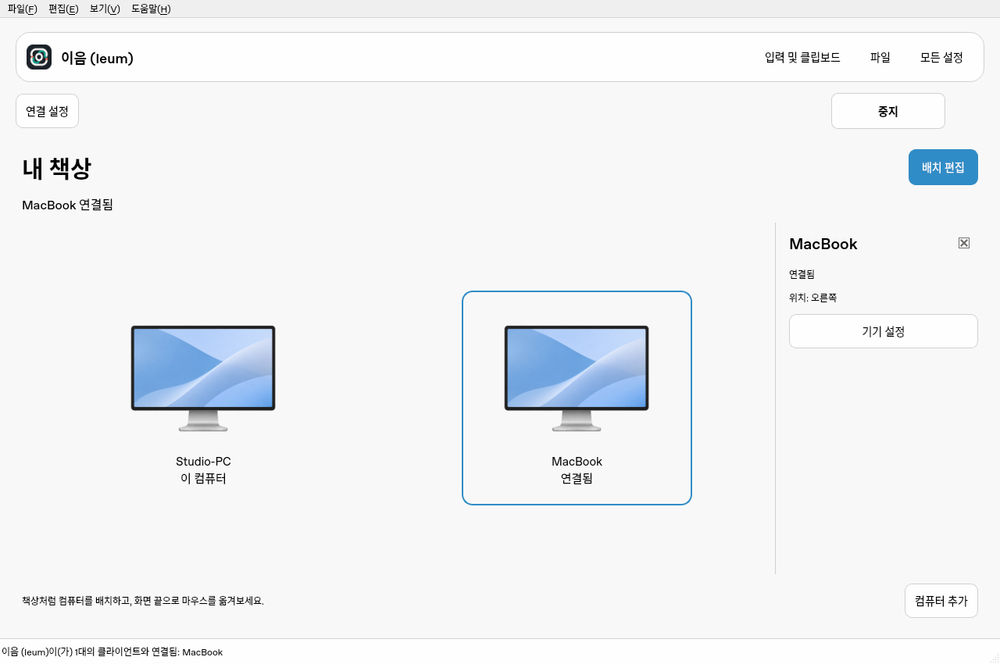
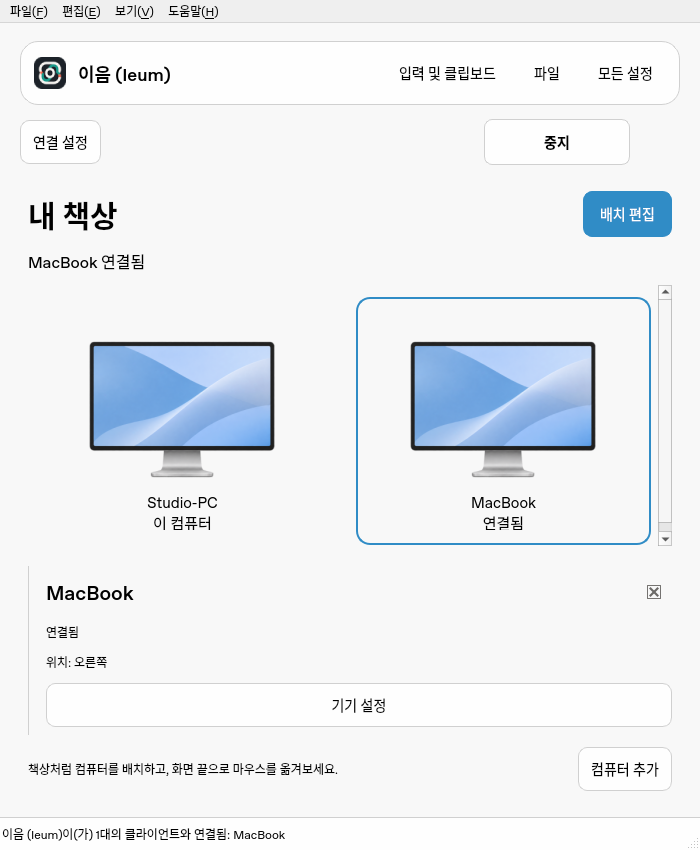
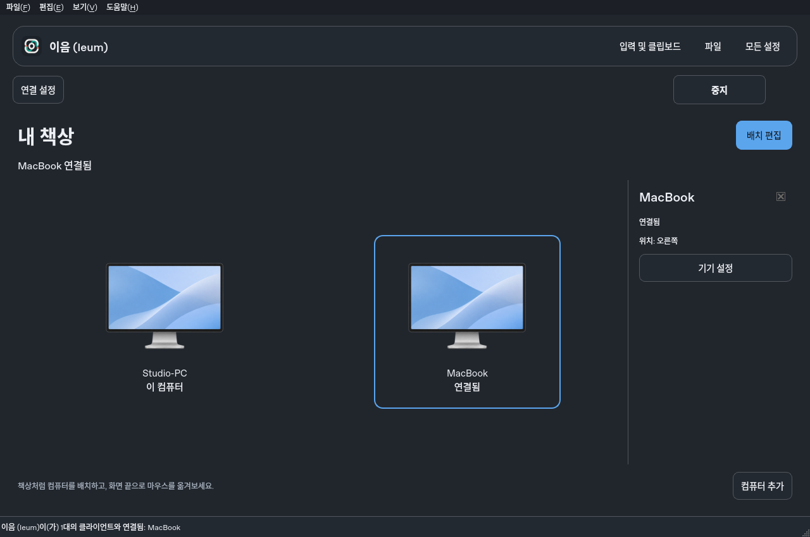

<!-- SPDX-FileCopyrightText: (C) 2026 Ieum contributors -->
<!-- SPDX-License-Identifier: GPL-2.0-only WITH LicenseRef-OpenSSL-Exception -->

# 내 책상 UI — alpha.31

메인 화면에서 컴퓨터 배치와 실제 연결 상태를 먼저 확인한다. 역할·주소·네트워크 설정은
접을 수 있는 연결 영역으로 옮기고, 기기를 선택했을 때만 해당 기기의 정보 패널을 연다.

## 동작

- 처음 연결할 때는 연결 설정을 펼친다. 공유를 시작하면 접고, 사용자가 다시 열 수 있다.
- 저장된 기기의 상대 위치를 유지해 표시한다. 연결 상태는 코어가 보고한 연결 목록과 별칭을
  사용하며, Tailscale 온라인 상태나 저장된 이름만으로 연결됐다고 표시하지 않는다.
- 기기 선택 시 이름·상태·위치·설정이 나타난다. 연결되지 않은 기기는 다음 행동과 연결 정보를 안내한다.
- 배치 편집에서 격자와 방향 버튼이 나타난다. 추가·이동·기기 설정은 초안이며 저장할 때 적용된다.
  취소하면 저장된 배치로 돌아간다. 다른 창에서 배치가 바뀌었으면 덮어쓰지 않고 다시 읽도록 안내한다.
- 잘못된 이름, 중복 이름/별칭, 범위 밖 이동과 호스트 제거를 막는다. 외부 설정 파일은 이 화면에서
  덮어쓰지 않는다. 클라이언트에서는 물리 배치를 추측하지 않고 호스트에서 편집하도록 안내한다.
- 시작·중지·재시도 취소·호스트 전환과 지문 승인, 입력·파일·설정·진단은 기존 경로를 사용한다.
  상세 연결 안내는 연결 설정과 F1에서 열 수 있다.

## 재료, 테마와 작은 창

Mac 상단 조작부에 시스템 `NSVisualEffectView`를 사용한다. 최신 Liquid Glass와 광학 표현이
동일하다고 주장하지 않는다. 투명도 줄이기·고대비에서는 불투명한 표면을 사용한다.
효과는 Qt 컨트롤 뒤의 형제 뷰에 배치하고 입력을 가로채지 않는다.
다른 플랫폼은 시스템 팔레트에 맞는 표면을 사용한다.

900px보다 좁은 작업 영역에서는 기기 패널을 아래로 옮긴다. 패널과 큰 배치는 스크롤을 지원한다.
배치 격자의 작은 셀은 모니터·이름·역할을 셀 안에 그린다. 밝음/어두움에서도 같은 정보 구조를 쓴다.

## 리소스와 검증 범위

주기적인 UI 타이머, 장식 애니메이션, 프레임마다 계산하는 블러를 추가하지 않는다.
공통 기기 그림은 작은 크기로 디코딩해 공유 캐시에서 사용한다. 상대 OS를 이름으로 추측하거나
화면 미리보기를 스트리밍하지 않는다. 레이아웃/연결 정보가 바뀔 때 UI를 갱신하고 교체한 선택 모델을 해제한다.

Linux Debug, GCC 14, Qt 6.8.2에서 GUI를 새로 빌드하고 관련 CTest 프로그램 25개를 통과했다.
새 `DeskWorkspaceTests`는 상태 표시, 저장 전 초안 유지, 취소, 저장 후 재로딩, 이름 검증,
외부 변경 덮어쓰기 방지와 외부 설정 파일 보호를 검사한다. 기존 연결 흐름·설정 검색·진단·로그 검사도 통과했다.

이 문서의 Linux 렌더링은 격리된 설정과 테스트용 코어·연결 정보를 사용한다. 실제 두 컴퓨터의
입력 전달이나 Mac 시스템 재질의 실기 검증을 뜻하지 않는다. 배포 전 네이티브 빌드와 패키지 검사는
릴리스 CI에서 수행한다. VoiceOver/Narrator, 200% 배율, 실제 Mac 재질과 재부팅 수용 시험은 별도로 확인해야 한다.

네트워크 3초 감시, Mac 트레이 5초 복구 검사, 매행 파일 로그 I/O의 추가 최적화는 별도 과제다.
새 CPU/RAM 절감률을 측정하거나 주장하지 않는다.
